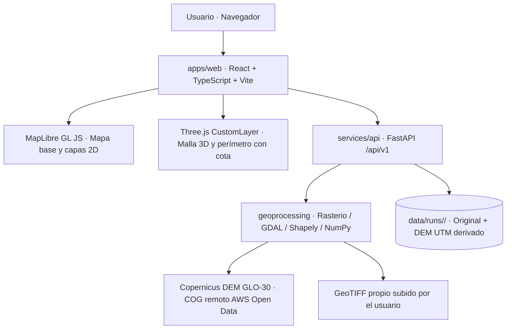

# Arquitectura — Visor 3D de Lotes e Hidrología (Complemento a RotaTerra)

## 1. Principio rector (SDD §1.1)

El sistema distingue explícitamente tres niveles de análisis y nunca presenta un nivel inferior como si fuera uno superior:

1. **Nivel 1 — Análisis topográfico (Fase 0 / Fase 1):** relieve derivado de un Modelo Digital de Elevación (MDE/MDT), pendiente, orientación, perfil altimétrico y rutas potenciales de drenaje.
2. **Nivel 2 — Estimación de escorrentía por evento (Fase 2 / Fase 3):** precipitación efectiva (p. ej. NRCS Curve Number) y distribución potencial simplificada.
3. **Nivel 3 — Simulación hidrodinámica 2D (Fase 4):** resolución temporal de lámina de agua (`water_depth_m`) y velocidad (`velocity_m_s`), sujeta a calibración con observaciones de campo.

En la **Fase 0** únicamente se implementa la base del **Nivel 1** (importación de lote, recorte/reproyección de DEM a CRS métrico UTM, control de calidad, visualización 3D georreferenciada, consulta puntual de cota/pendiente y perfil altimétrico).

## 2. Separación de capas

- **`geoprocessing/`**: librería Python independiente de FastAPI. Calcula huso UTM (`EPSG:327xx`), valida geometrías GeoJSON, descarga ventanas COG de Copernicus GLO-30 por rangos HTTP validando certificados TLS del sistema operativo (`truststore`), reproyecta a UTM sin refinar artificialmente la resolución original, genera el informe de calidad, calcula pendiente/orientación (método de Horn), interpola cotas bilinealmente y muestrea perfiles.
- **`services/api/`**: API REST FastAPI bajo `/api/v1` con contratos Pydantic estrictos y persistencia trazable por corrida (`field.json`, `source/`, `dem_utm.tif`, `terrain.json`).
- **`apps/web/`**: SPA en React + TypeScript + Vite que integra MapLibre GL JS con una capa WebGL personalizada (`CustomLayerInterface`) de Three.js usando `MercatorCoordinate.fromLngLat` para que cada vértice del DEM y del perímetro parcelario coincida exactamente con el mapa base.
