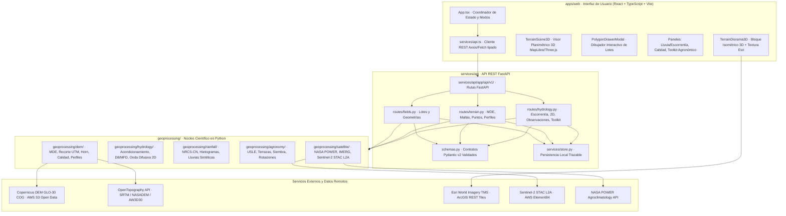

# Arquitectura del Sistema — Complemento a RotaTerra

## 1. Principio Rector (SDD §1.1)

El sistema distingue formalmente tres niveles de análisis hidrológico y ambiental, garantizando que ninguna visualización o modelo simplificado sea presentado al agrónomo con una jerarquía científica que no le corresponde:

1. **Nivel 1 — Análisis Topográfico (Fases 0 y 1):** Relieve tridimensional derivado del MDE (Copernicus DEM GLO-30, OpenTopography o GeoTIFF de alta resolución), pendientes y orientación (Horn 1981), perfiles altimétricos, acondicionamiento hidrológico (Wang & Liu 2006) y enrutamiento de flujo (D8 y MFD Quinn/Freeman).
2. **Nivel 2 — Estimación de Escorrentía y Lluvia de Diseño (Fases 2 y 3):** Precipitación acumulada, temporal y de diseño con el método NRCS Curve Number (USDA 1986), cálculo de lluvia efectiva $Q$, humedad antecedente (AMC I/II/III) y tiempos de concentración.
3. **Nivel 3 — Simulación Hidrodinámica 2D (Fase 4):** Modelación bidimensional en onda difusiva sobre la grilla UTM resolviendo la evolución espacio-temporal de la lámina de agua (`water_depth_m`) y los vectores de velocidad (`velocity_m_s`), sujeta a calibración con observaciones de campo y marcas de agua.
4. **Capa Superior — Suite Agronómica Complementaria (Fase 5):** 8 herramientas aplicadas al lote para toma de decisiones productivas y de conservación: erosión USLE/RUSLE, balance hídrico mensual FAO-56, riesgo de anegamiento en fechas reales, terrazas a nivel, calculadora de siembra INTA, comparador de rotaciones trienales, monitor de vigor satelital NDVI (Sentinel-2 L2A) y riesgo histórico de heladas (NASA POWER).

---

## 2. Diagrama de Componentes y Flujo de Datos

---

## 3. Persistencia y Estructura en Disco (`data/runs/`)

Cada lote creado o dibujado cuenta con un directorio propio e independiente en `data/runs/<field_id>/` (ignorado por Git):

- `field.json`: Definición del lote, geometría GeoJSON validada en `EPSG:4326`, bounding box, superficie en `ha` y `km²`, y metadatos de creación.
- `source/`: Archivo DEM original en su proyección nativa tal cual fue descargado o subido por el usuario (inalterable, principio de trazabilidad SDD §6.2).
- `dem_utm.tif`: MDE recortado y reproyectado al huso UTM métrico del lote (`EPSG:327xx` en hemisferio sur) sin interpolaciones ficticias.
- `terrain.json`: Estadísticas topográficas, cotas mín/máx/media, pendiente media y reporte de calidad de elevación.
- `hydrology.json`: Parámetros de la simulación hidrológica estática (D8, MFD, TWI, SPI, cuencas de aporte y red de drenaje).
- `hydrology_grids.npz`: Archivo NumPy comprimido con las grillas raster alineadas celda a celda (`flow_accum_mfd`, `twi`, `spi`, `soil_loss_t_ha`, `agronomic_zone_id`, `ndvi`).
- `toolkit.json`: Resultados de las 8 herramientas agronómicas complementarias con sus parámetros de corrida y advertencias de degradación.
- `observations.json`: Registro de puntos de observación a campo (cárcavas, alcantarillas, marcas de inundación, cotas verificadas).

---

## 4. Contratos de Datos y Sincronización Estricta (Python ↔ TypeScript)

Todos los contratos de entrada y salida están tipados y validados en doble vía:
- **Backend:** Modelos Pydantic v2 en `services/api/app/schemas.py`.
- **Frontend:** Interfaces TypeScript en `apps/web/src/types/api.ts`.
- **Verificación Continua:** Test E2E de paridad estricta (`test_e2e_t1_f10_04`) que analiza con el árbol AST de Python y regex de TypeScript que no exista discrepancia en los nombres ni en la obligatoriedad de campos entre ambos entornos.

---

## 5. Respaldo y Manejo de Conexión Offline (Regla R4)

Si una fuente remota (NASA POWER, Sentinel-2 STAC, Esri Tiles) no responde o presenta tiempos de espera excesivos:
1. No se sintetizan datos ficticios ni se inventan series meteorológicas o valores de vegetación.
2. El sistema responde con `status: "unavailable"` o `None` acompañado de mensajes descriptivos en la lista de `warnings`.
3. El frontend muestra distintivos de estado claros (ej. badge amarillo de advertencia o gris de servicio no disponible) permitiendo al usuario continuar utilizando las herramientas puramente topográficas y los modelos de lluvia manual.
