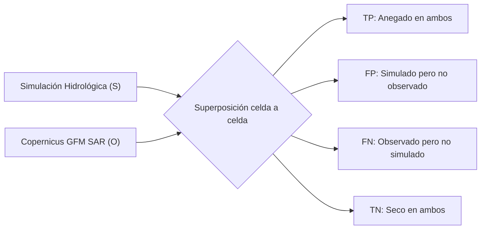

# Spec 012: Validación Empírica con Observaciones Satelitales y Terrestres (Copernicus GFM e ICESat-2 ATL08)

**Estado:** Borrador para revisión (requiere aprobación de Hernán)  
**Fecha:** 23/11/2026  
**Rama:** `spec/012-validacion-con-observaciones`  
**Issue:** #18 (`[12] Fuentes · F0: actualizar data-sources y spec 012 de validación`)  
**Autor:** Antigravity  

---

## 1. Justificación y Objetivos de la Validación

Para garantizar que **Complemento a RotaTerra** sea una herramienta agronómica confiable y científicamente verificable, ninguna salida del modelo (ni la altimetría regional ni el encharcamiento simulado) puede ser aceptada sin contraste empírico frente a observaciones directas independientes.

Esta especificación formaliza dos protocolos de validación cuantitativa:
1. **Validación Altimétrica Fina:** Contraste de los modelos digitales de elevación (Copernicus GLO-30, Google GEM-15 DTM y Fusión) frente a trazas orbitales de fotones de **ICESat-2 ATL08** (< 0,10 m de error vertical).
2. **Validación de Encharcamiento e Inundación:** Contraste de las áreas anegables simuladas frente a detecciones de radar de apertura sintética (SAR) de **Copernicus Global Flood Monitoring (GFM)** y la máscara histórica de **JRC Global Surface Water**.

---

## 2. Protocolo 1: Validación Altimétrica con ICESat-2 ATL08

### 2.1 Características de la Verdad de Terreno (ICESat-2 ATL08)
El satélite ICESat-2 (NASA) transporta el altímetro láser de conteo de fotones ATLAS (532 nm). El producto **ATL08** (*Land and Vegetation Height*) extrae la cota topográfica del terreno desnudo ($h_{\text{te\_best\_fit}}$) con una huella de ~11 m y una precisión vertical probada $< 0,10\text{ m}$ en terrenos planos a suavemente ondulados, georreferenciada sobre el elipsoide WGS84.

### 2.2 Metodología de Contraste
1. **Selección de trazas orbitales:** Se filtran los pases de ICESat-2 que atraviesan el departamento General Pedernera y la cuenca de Villa Mercedes (San Luis) en condiciones nocturnas y cielo despejado (`cloud_flag_atm == 0`).
2. **Conversión geodésica de datum vertical:**
   Las alturas elipsoidales de ICESat-2 ($h$) se transforman a cotas ortométricas ($H$) mediante el geoide EGM2008 (o EGM96 según el DEM analizado):
   $$H_{\text{ICESat-2}} = h - N_{\text{geoide}}$$
3. **Muestreo bilineal en el DEM:** Para cada punto fotónico $(x_i, y_i)$, se interpola bilinealmente la elevación correspondiente en el DEM evaluado: $z_{\text{DEM}}(x_i, y_i)$.
4. **Métricas de dispersión y error:**
   Para la muestra de diferencias $\Delta z_i = z_{\text{DEM}}(x_i, y_i) - H_{\text{ICESat-2}}(x_i)$:
   - **Sesgo sistemático (Mediana):** $\text{Bias} = \text{median}(\Delta z)$
   - **Dispersión robusta (NMAD):**
     $$\text{NMAD} = 1,4826 \cdot \text{median}(|\Delta z_i - \text{median}(\Delta z)|)$$
   - **Error cuadrático medio (RMSE):**
     $$\text{RMSE} = \sqrt{\frac{1}{n} \sum_{i=1}^n (\Delta z_i)^2}$$
   - **Error lineal al 90 % de confianza (LE90):** percentil 90 del valor absoluto de los residuos.

---

## 3. Protocolo 2: Validación de Anegamiento con Copernicus GFM

### 3.1 Detección SAR de Agua Superficial (Copernicus GFM)
El servicio **Copernicus Global Flood Monitoring (GFM)** procesa automáticamente las imágenes de Sentinel-1 C-SAR (20 m) utilizando un ensamble de tres algoritmos independientes de umbralizado y redes neuronales para mapear agua superficial abierta incluso bajo densa nubosidad y temporales de lluvia.

### 3.2 Matriz de Confusión y Métricas Espaciales
Para un evento hidrológico histórico documentado (por ejemplo, el temporal del 25 de febrero de 2024 en San Luis):
1. Se corre la simulación hidrológica en el lote con la lluvia registrada por la estación REM más cercana (#23 / PR #100).
2. Se obtiene la máscara ráster binaria de agua observada por Copernicus GFM ($O \in \{0, 1\}$).
3. Se binariza el mapa de encharcamiento simulado ($S \in \{0, 1\}$) considerando celdas con tirante de agua $\ge 0,05\text{ m}$.
4. Se computa la matriz de confusión espacial celda a celda:
   - **$TP$ (Verdaderos Positivos):** Celdas simuladas anegadas y confirmadas por GFM.
   - **$FP$ (Falsos Positivos):** Celdas simuladas anegadas pero secas en GFM (sobreestimación).
   - **$FN$ (Falsos Negativos):** Celdas secas en la simulación pero anegadas en GFM (omisión).
   - **$TN$ (Verdaderos Negativos):** Celdas secas en ambos.



### 3.3 Índices Cuantitativos de Calidad
- **Índice de Jaccard (Intersection over Union, IoU):**
  $$\text{IoU} = \frac{TP}{TP + FP + FN}$$
  - *Criterio de aceptación:* $\text{IoU} \ge 0,55$ en eventos con anegamiento generalizado $\ge 10\text{ ha}$.
- **Precisión (Fiabilidad):**
  $$\text{Precision} = \frac{TP}{TP + FP}$$
- **Exhaustividad (Sensibilidad / Recall):**
  $$\text{Recall} = \frac{TP}{TP + FN}$$
- **F1-Score (Media armónica):**
  $$F_1 = 2 \cdot \frac{\text{Precision} \cdot \text{Recall}}{\text{Precision} + \text{Recall}}$$

---

## 4. Parámetros en `geoprocessing/supuestos.py`

| Constante | Valor | Unidad | Fuente / Justificación | Editable |
|---|---|---|---|---|
| `SUPUESTO_VALIDACION_TIRANTE_MINIMO_M` | `0.05` | m | Tirante mínimo de agua simulada para considerar la celda como anegada frente al radar SAR. | Sí |
| `SUPUESTO_VALIDACION_IOU_MINIMO_ACEPTABLE` | `0.50` | adimensional | Umbral mínimo de coincidencia espacial aceptable según literatura CEMS. | Sí |
| `SUPUESTO_VALIDACION_ICESAT2_MAX_DIST_M` | `30.0` | m | Distancia máxima para asociar un punto fotónico ICESat-2 al centroide de celda DEM. | Sí |

---

## 5. Salidas en API y Esquema de Reporte de Validación

```json
{
  "validacion_observaciones": {
    "fecha_evento": "2024-02-25",
    "fuente_observacion": "Copernicus GFM (Sentinel-1 SAR 20m)",
    "superficie_observada_ha": 18.4,
    "superficie_simulada_ha": 16.2,
    "metricas_espaciales": {
      "iou_jaccard": 0.68,
      "precision": 0.81,
      "recall": 0.79,
      "f1_score": 0.80
    },
    "calificacion_ajuste": "optimo"
  }
}
```

---

## 6. Plan de Pruebas Automatizadas (CI sin Internet)

1. **Test de métricas de confusión (`test_validation_metrics_calculation`):**
   - Grillas sintéticas $10 \times 10$ con configuraciones conocidas de $TP, FP, FN$ comprobando que `iou`, `precision`, `recall` y `f1` coincidan con el cálculo teórico exacto.
2. **Test de perfilado altimétrico (`test_altimetric_validation_icesat2`):**
   - Fixture local con 50 puntos ICESat-2 y un recorte GeoTIFF sintético con sesgo conocido ($+1,0\text{ m}$); el validador debe recuperar exactamente el sesgo y un $\text{NMAD} \approx 0,0\text{ m}$.
