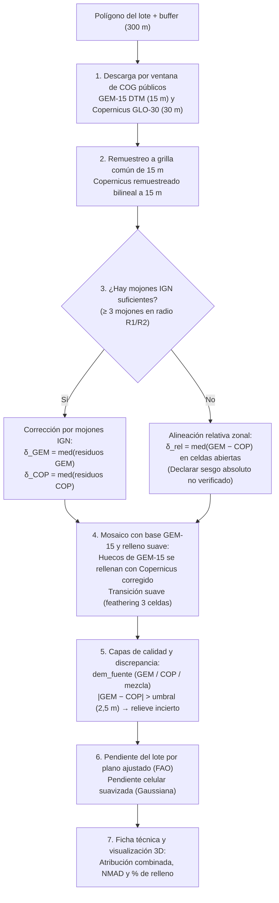

# Spec 014: Relieve Base Regional (Fusión Copernicus GLO-30 + Google GEM-15 DTM), Pendiente del Lote por Plano Ajustado y Calibración con Mojones IGN

**Estado:** Borrador para revisión (requiere aprobación de Hernán)  
**Fecha:** 23/11/2026  
**Rama:** `spec/014-relieve-base-copernicus`  
**Issue:** #73 (`[41] Relieve base: reemplazar NASADEM por Copernicus GLO-30 / GEM-15 y pendiente del lote por plano ajustado`)  
**Autor:** Antigravity  

---

## 1. Justificación y Diagnóstico del Problema

### 1.1 El problema de NASADEM y el ruido en celdas de 30 m
El sistema original venía utilizando como respaldo regional modelos digitales de elevación derivados de la misión SRTM (específicamente NASADEM 30 m del año 2000). Evaluaciones sistemáticas globales de modelos de elevación (Meadows, Jones & Reinke 2024, *Int. J. Digital Earth* 17(1), sec. 4) constatan que NASADEM y SRTM presentan importantes errores verticales residuales y ruido de alta frecuencia frente a puntos geodésicos terrestres en áreas llanas y propensas a anegamiento.

Con celdas de 30 m de resolución espacial, un error aleatorio celda a celda de $\pm 1\text{ m}$ genera una pendiente aparente espuria:
$$\text{Pendiente aparente} = \frac{\Delta z}{\Delta x} = \frac{1\text{ m}}{30\text{ m}} \approx 3,33\%$$

Por esta razón matemática, en zonas típicamente llanas como Villa Mercedes (San Luis), Trenque Lauquen o Pergamino —donde la pendiente regional real del terreno oscila entre 0,2 % y 0,8 %—, el cálculo celular tradicional (método de Horn) arrojaba valores promedio y medianas de 2,5 % a 4,5 % (entre 2 y 8 veces la pendiente real del lote).

**Consecuencias agronómicas y de modelado:**
1. **Sobreestimación severa de la erosión hídrica:** En la ecuación universal de pérdida de suelo (USLE/RUSLE), el factor topográfico $LS$ crece fuertemente con la pendiente ($S$). Una pendiente inflada de 0,5 % a 2,5 % multiplica la tasa calculada de pérdida de suelo ($A$, en $\text{t}/(\text{ha}\cdot\text{año})$) por un factor de 2 a 4, generando falsas alarmas de degradación.
2. **Microcanales artificiales en el solver hidrológico:** El ruido celda a celda genera pequeñas depresiones y canales espurios que desconectan el escurrimiento laminar real.
3. **Pérdida de confianza del productor agropecuario:** Informar en la ficha técnica "Pendiente del lote: 2,76 %" en un campo visiblemente plano desacredita la herramienta frente al asesor agronómico.

---

### 1.2 Prueba empírica real: Copernicus GLO-30 vs. Google GEM-15 DTM vs. Mojones IGN (22/11/2026)
Durante la investigación geodésica se contrastaron en la tesela de Villa Mercedes (latitud $-34^\circ$ a $-33^\circ$, longitud $-66^\circ$ a $-65^\circ$, San Luis) los modelos digitales disponibles contra mojones geodésicos oficiales de la Red de Nivelación Geométrica del Instituto Geográfico Nacional (IGN), separando el análisis por red geodésica:

| Red IGN (llanura, cota $< 600\text{ m}$) | $n$ | Fuente DEM | Sesgo (mediana) | NMAD (robusto) | RMSE | LE90 |
|---|---|---|---|---|---|---|
| **Alta precisión** | 44 | **Google GEM-15 DTM** | **$+3,09\text{ m}$** | **$0,91\text{ m}$** | $3,24\text{ m}$ | $4,76\text{ m}$ |
| | | **Copernicus GLO-30** | **$+0,50\text{ m}$** | **$1,08\text{ m}$** | $1,59\text{ m}$ | $2,42\text{ m}$ |
| | | **Fusión (GEM-15 cal. + COP)** | **$0,00\text{ m}$** | **$0,91\text{ m}$** | $1,19\text{ m}$ | $1,65\text{ m}$ |
| **Alta precisión + precisión (llanura)** | 76 | **Google GEM-15 DTM** | $+3,14\text{ m}$ | $1,13\text{ m}$ | $3,96\text{ m}$ | $4,86\text{ m}$ |
| | | **Copernicus GLO-30** | $+0,45\text{ m}$ | $1,15\text{ m}$ | $2,77\text{ m}$ | $2,61\text{ m}$ |
| | | **Fusión RotaTerra** | $0,00\text{ m}$ | **$0,99\text{ m}$** | $1,95\text{ m}$ | $1,92\text{ m}$ |
| Topográfica ⚠️ *(excluida)* | 45 | Copernicus GLO-30 | $+0,35\text{ m}$ | $3,75\text{ m}$ | $9,40\text{ m}$ | $16,20\text{ m}$ |

**Exclusión justificada de la red topográfica secundaria:**
La red topográfica **no debe utilizarse para validación ni calibración**. Presenta una dispersión muy elevada ($\text{NMAD} = 3,75\text{ m}$, $\text{LE90} = 16,20\text{ m}$ frente a los $\approx 1\text{ m}$ de las redes principales), evidenciando coordenadas con redondeo grosero o errores históricos de transcripción en los partes de nivelación secundaria. Asimismo, se descartó el mojón topográfico `PF1n(75)n` cuya cota publicada es $26,226\text{ m}$ mientras que Copernicus GLO-30 da $\approx 936\text{ m}$ en ese punto.

**Lectura técnica:**
- **Copernicus GLO-30** presenta un sesgo absoluto mínimo ($+0,45\text{ m}$ a $+0,50\text{ m}$) y cobertura continua sin huecos, pero es un modelo de superficie (DSM) con resolución de 30 m que incluye la vegetación arbórea.
- **Google GEM-15 DTM** es un modelo de terreno desnudo (DTM) con el doble de resolución (15 m) y una excelente dispersión local ($\text{NMAD} = 0,91\text{ m}$ en alta precisión). Sin embargo, presenta un **sesgo sistemático de $\approx +3,1\text{ m}$** (debido a diferencias de datum EGM96 y offsets regionales documentados) y **enmascara huecos** en cuerpos de agua (+9 m), salinas y superficies de baja textura (justamente bajos y lagunas donde se acumula el agua).
- **Fusión RotaTerra:** Al calibrar el sesgo de GEM-15 con mojones IGN (o contra la mediana de Copernicus en celdas abiertas) y rellenar sus huecos con Copernicus corregido, se obtiene lo mejor de ambos mundos: **resolución de 15 m de terreno desnudo**, **dispersión óptima ($\text{NMAD} \le 0,91\text{ m}$)** y **continuidad hidrológica sin huecos**.

---

### 1.3 Prueba de pendiente: cálculo celular vs. plano ajustado
En la misma zona de San Luis, se evaluó la pendiente en 4 ventanas agronómicas de $\approx 410\text{ ha}$ cada una:

| Ventana | Relieve total | Pendiente píxel (mediana Horn) | Pendiente píxel (p90 Horn) | **Pendiente del plano ajustado (FAO)** |
|---|---|---|---|---|
| Sur Villa Mercedes A ($-65,40;\ -33,85$) | $13,0\text{ m}$ | $0,89\%$ | $3,52\%$ | **$0,37\%$** |
| Sur Villa Mercedes B ($-65,30;\ -33,95$) | $9,8\text{ m}$ | $0,81\%$ | $1,68\%$ | **$0,37\%$** |
| Oeste Villa Mercedes ($-65,60;\ -33,75$) | $13,3\text{ m}$ | $1,94\%$ | $4,25\%$ | **$0,23\%$** |
| Este Villa Mercedes ($-65,25;\ -33,70$) | $40,3\text{ m}$ | $1,74\%$ | $3,94\%$ | **$1,12\%$** |

**Conclusión:** La pendiente celular sin filtrar es entre **2 y 8 veces superior** a la pendiente general del lote. La pendiente regional y el rumbo del potrero deben surgir de un **plano ajustado de mínimos cuadrados**, mientras que el análisis de escurrimiento distribuido celda a celda debe emplear una pendiente celular suavizada mediante filtrado espacial.

---

## 2. Reglas Innegociables de Representación e Integridad de Datos

1. **Cumplimiento estricto de `docs/metodologia.md`:** Cada valor numérico en la ficha técnica de relieve tiene exactamente uno de los tres estados:
   - **Dato con fuente:** Fuente consultada con documento + DOI / URL oficial registrado en `docs/data-sources.md`.
   - **Supuesto editable:** Declarado en `geoprocessing/supuestos.py` con justificación agronómica y modificable por el usuario.
   - **Sin dato:** Declarado explícitamente como `null` con calidad `"descartada"` y motivo. Quedan terminantemente prohibidos valores inventados o de respaldo silenciosos.
2. **Prioridad de fuentes de relieve (orden jerárquico):**
   - **Prioridad 1 (Máxima):** Relevamiento propio del usuario (Dron RTK / LiDAR / GNSS en GeoTIFF). Se respetan sus cotas y resolución sin sobrescritura.
   - **Prioridad 2 (Por defecto nacional):** **FUSIÓN Copernicus GLO-30 + Google GEM-15 DTM** (grilla 15 m, sesgo corregido, base DTM y relleno de huecos sin escalones).
   - **Prioridad 3 (Fallback automático):** **Copernicus GLO-30 solo**, si el servicio de GEM-15 no responde, con notificación explícita en la ficha técnica.
   - **Descartados para relieve base:** MDE-Ar 30 (sesgo vertical sistemático de $+2,8\text{ m}$ no calibrado), NASADEM (obsoleto: derivado de la misión SRTM del año 2000). FABDEM solo si se habilita uso no comercial (licencia CC BY-NC-SA 4.0).
3. **Eficiencia en ingesta:** Lectura por ventana (*Windowed read* mediante peticiones HTTP `Range` sobre los COG públicos de AWS y Google Cloud Storage), descargando exclusivamente el área del lote más su buffer de entorno sin transferir teselas enteras.
4. **Pruebas 100 % aisladas de la red:** Ningún test del pipeline de CI dependerá de internet. Se utilizarán fixtures sintéticos y recortes georreferenciados almacenados localmente.

---

## 3. Especificación Técnica de las Fuentes Regionales

### 3.1 Google GEM-15 DTM v1 (Terreno Desnudo 15 m)
- **Identificador de producto:** Google Earth Engine `projects/climate-and-sustainability/assets/gem-15_v1` (experimental, "under review").
- **DOI / Cita:** Batchu et al. (2026), EarthArXiv, DOI `10.31223/X55N75`.
- **Tipo de superficie:** Modelo Digital de Terreno (DTM, bare ground sin árboles ni edificaciones).
- **Resolución nominal:** 15 m (UTM fajas zonales, faja 20S para San Luis/Córdoba).
- **Datum horizontal:** WGS84 (EPSG:32720 / UTM 20S).
- **Datum vertical:** Geoide EGM96.
- **Licencia:** Libre bajo Creative Commons **CC-BY 4.0** (atribución obligatoria: *«This dataset is produced by Google»*).
- **Acceso:** COG públicos en Cloud Storage (`gs://climate-and-sustainability/gem-15/` o endpoint HTTP público sin autenticación).
- **Enmascaramiento y huecos:** GEM-15 enmascara cuerpos de agua (+9 m), salinas, superficies de baja textura radiométrica y píxeles con discrepancia $> 50\text{ m}$ respecto a Copernicus.

### 3.2 Copernicus DEM GLO-30 (Superficie 30 m)
- **Identificador de producto:** Copernicus DEM GLO-30 (European Space Agency / Airbus Defence and Space).
- **DOI:** `10.5270/ESA-c5d3d65`.
- **Tipo de superficie:** Modelo Digital de Superficie (DSM, incluye árboles y vegetación alta).
- **Resolución nominal:** 1 segundo de arco ($\approx 30\text{ m}$ en ecuador; $\approx 25\text{ m}$ en $34^\circ\text{ S}$).
- **Datum horizontal:** WGS84 (EPSG:4326).
- **Datum vertical:** Geoide EGM2008 (alturas ortométricas en metros).
- **Licencia:** Libre y abierta con atribución requerida: *«Copernicus DEM: © DLR e.V. 2010-2014 y © Airbus Defence and Space GmbH 2014-2018, provisto bajo COPERNICUS por la Unión Europea y la ESA»*.
- **Acceso:** Bucket público de AWS Open Data (`https://copernicus-dem-30m.s3.amazonaws.com/`).

---

## 4. Flujo de Fusión por Lote (Decisión de Hernán, Issue #73)

La API procesa siempre la **fusión de ambas fuentes** mediante el siguiente flujo de 7 pasos:



### 4.1 Paso 1: Descarga por ventana (*Windowed Read*)
Para el bounding box del lote con su buffer agronómico de 300 m:
- Se leen las celdas de GEM-15 DTM desde `gs://climate-and-sustainability/gem-15/`.
- Se leen las celdas de Copernicus GLO-30 desde `https://copernicus-dem-30m.s3.amazonaws.com/`.
- Si el servidor de GEM-15 no responde o arroja error HTTP, el sistema realiza **fallback automático a Copernicus GLO-30 solo** y registra la contingencia en la ficha técnica.

### 4.2 Paso 2: Unificación a grilla común de 15 m
- La geometría de GEM-15 (15 m, proyección UTM correspondiente) define la matriz maestra de celdas.
- Copernicus GLO-30 se proyecta y remuestrea mediante interpolación bilineal a la grilla de 15 m coincidente celda a celda.

### 4.3 Paso 3: Corrección del sesgo vertical por fuente
1. **Con mojones IGN en el radio de búsqueda (R1 = 25 km, R2 = 50 km):**
   - Para cada fuente se computan los residuos frente a los mojones de nivelación geométrica de alta precisión y precisión:
     $$\Delta z_{\text{GEM}, j} = Z_{\text{GEM}, j} - Z_{\text{IGN}, j}, \qquad \Delta z_{\text{COP}, j} = Z_{\text{COP}, j} - Z_{\text{IGN}, j}$$
   - Se obtienen los sesgos locales:
     $$\delta_{\text{GEM}} = \operatorname{mediana}(\{\Delta z_{\text{GEM}, j}\}), \qquad \delta_{\text{COP}} = \operatorname{mediana}(\{\Delta z_{\text{COP}, j}\})$$
   - Se ajustan ambas matrices:
     $$Z_{\text{GEM, cal}} = Z_{\text{GEM}} - \delta_{\text{GEM}}, \qquad Z_{\text{COP, cal}} = Z_{\text{COP}} - \delta_{\text{COP}}$$
2. **Sin mojones IGN suficientes ($n < 3$):**
   - Se alinea GEM-15 a Copernicus calculando la mediana de diferencia en celdas abiertas del lote (excluyendo celdas con NDVI elevado o montes donde el DSM difiere del DTM por altura de árboles):
     $$\delta_{\text{rel}} = \operatorname{mediana}(Z_{\text{GEM}} - Z_{\text{COP}})$$
   - Se declara en la ficha técnica: `"Sesgo absoluto no verificado (sin mojones IGN en 50 km)"`.

### 4.4 Paso 4: Mosaico con base GEM-15 y relleno de huecos con transición suave (*Feathering*)
- **Base:** Celdas válidas de $Z_{\text{GEM, cal}}$.
- **Huecos en GEM-15:** En lagunas, bajos inundables y salinas donde GEM-15 enmascara datos (valores `NaN` o nodata), se insertan los valores de $Z_{\text{COP, cal}}$.
- **Transición suave (*Feathering*):** En el borde entre GEM-15 y Copernicus (zona de transición de 3 celdas, $\approx 45\text{ m}$), se aplica una ponderación lineal con función de peso suave (*smoothstep* o distancia euclídea normalizada $w \in [0, 1]$):
  $$Z_{\text{fusión}} = (1 - w) \cdot Z_{\text{GEM, cal}} + w \cdot Z_{\text{COP, cal}}$$
  Esta transición previene la aparición de escalones artificiales o falsos taludes que el solver 2D interpretaría erróneamente como bordos de retención.

### 4.5 Paso 5: Capa de calidad `dem_fuente` y mapa de discrepancia
Se generan dos matrices accesorias de calidad:
1. **Capa `dem_fuente`:** Matriz categórica por celda:
   - `1`: Terreno GEM-15 DTM directo.
   - `2`: Relleno Copernicus GLO-30.
   - `3`: Zona de mezcla / transición suave (*feather*).
2. **Mapa de discrepancia $|Z_{\text{GEM, cal}} - Z_{\text{COP, cal}}|$:**
   - Si la discrepancia vertical supera el umbral editable declarado en `geoprocessing/supuestos.py` (`SUPUESTO_DEM_DISCREPANCIA_UMBRAL_M = 2.5 m`), la celda se clasifica en la capa de calidad como `"relieve incierto"`.
   - Estas discrepancias elevadas indican típicamente: presencia de montes / cortinas forestales (donde el DSM de Copernicus ve la copa de los árboles a $+3\text{ a }+8\text{ m}$ sobre el DTM de GEM-15) o subsidencia geomorfológica local.

### 4.6 Cuidados agronómicos especiales
- **DSM vs. DTM en montes:** Copernicus incluye árboles; GEM-15 DTM modela el suelo desnudo. En cortinas forestales y montes nativos, la diferencia es real. No se deben utilizar celdas boscosas para estimar la alineación de sesgo, ni rellenar huecos de GEM con cotas de copas de árboles sin advertencia.
- **Huecos en lagunas y bajos:** La prueba empírica demostró que en 2 de 4 ventanas al sur de Villa Mercedes, GEM-15 presenta huecos enmascarados justamente en bajos y lagunas. Por lo tanto, el relleno con Copernicus **es obligatorio y automático**.

---

## 5. Algoritmo de Pendiente y Rumbo del Lote por Plano Ajustado

### 5.1 Formulación matemática (FAO T0231E cap. 6, ec. 117)
Para caracterizar la macro-pendiente y la orientación general de escurrimiento del lote sin sufrir por el ruido celda a celda, se ajusta un plano de regresión de mínimos cuadrados ordinarios sobre las celdas válidas del lote:

$$Z(X, Y) = a + b \cdot (X - \bar{X}) + c \cdot (Y - \bar{Y})$$

Donde:
- $X, Y$: Coordenadas métricas proyectadas UTM (metros).
- $\bar{X}, \bar{Y}$: Coordenadas del centroide del lote.
- $Z$: Cota de elevación de la fusión en metros.
- $a = \bar{Z}$: Cota media en el centroide.
- $b = \frac{\partial Z}{\partial X}$: Gradiente zonal Oeste-Este.
- $c = \frac{\partial Z}{\partial Y}$: Gradiente zonal Sur-Norte.

Resolviendo el sistema lineal normal:
$$\begin{bmatrix} b \\ c \end{bmatrix} = \begin{bmatrix} \sum x_i^2 & \sum x_i y_i \\ \sum x_i y_i & \sum y_i^2 \end{bmatrix}^{-1} \begin{bmatrix} \sum x_i (Z_i - \bar{Z}) \\ \sum y_i (Z_i - \bar{Z}) \end{bmatrix}$$

### 5.2 Métricas derivadas
1. **Magnitud de la pendiente del plano ($S$):**
   $$s = \sqrt{b^2 + c^2} \quad (\text{en m/m}), \qquad S_{\%} = 100 \cdot \sqrt{b^2 + c^2} \quad (\text{en \%})$$
2. **Rumbo de máximo descenso ($\theta$):**
   $$\theta = \left(\operatorname{atan2}(-b, -c) \cdot \frac{180^\circ}{\pi} + 360^\circ\right) \pmod{360^\circ}$$
3. **Bondad de ajuste ($R^2$):**
   $$R^2 = 1 - \frac{\sum (Z_i - \hat{Z}_i)^2}{\sum (Z_i - \bar{Z})^2}$$
   - Si $R^2 < 0,70$: La ficha informa la advertencia: *"Relieve complejo multiescurrimiento (R² < 0,70); la pendiente del plano describe solo la tendencia macroscópica"*.

### 5.3 Suavizado de la pendiente celular (para USLE y flujo 2D)
Sobre la matriz de fusión se aplica un filtro Gaussiano con radio de vecindad de 2 a 3 celdas ($\sigma = 1,0$ a $1,5$, equivalente a $\approx 30\text{ a }45\text{ m}$ en grilla de 15 m) antes de computar el gradiente diferencial de Horn, eliminando micro-rugosidades espurias en áreas planas.

---

## 6. Ficha Técnica Visible de Relieve en API y Frontend

Toda respuesta del endpoint `/api/v1/fields/{id}/terrain` incluirá obligatoriamente el siguiente bloque enriquecido:

```json
{
  "dem_source": {
    "id": "fusion_gem15_copernicus",
    "name": "Fusión GEM-15 DTM (Google) + Copernicus GLO-30 (ESA)",
    "surface_type": "DTM (Terreno desnudo calibrado)",
    "nominal_resolution_m": 15.0,
    "vertical_datum": "EGM2008 / IGN Oficial (alturas ortométricas)",
    "fallback_active": false,
    "gem15_coverage_pct": 92.4,
    "copernicus_fill_pct": 7.6,
    "discrepancy_uncertain_area_pct": 1.2,
    "local_calibration": {
      "calibrated_with_ign": true,
      "ign_points_count": 44,
      "gem15_bias_corrected_m": 3.09,
      "copernicus_bias_corrected_m": 0.50,
      "nmad_accuracy_m": 0.91,
      "radius_km": 25.0
    },
    "attributions": [
      "GEM-15 DTM: Produced by Google (CC-BY 4.0, experimental, DOI 10.31223/X55N75)",
      "Copernicus DEM: © DLR e.V. / Airbus Defence and Space / ESA (Open Access)",
      "Puntos de calibración: Red de Nivelación Geométrica del Instituto Geográfico Nacional (IGN)"
    ],
    "disclaimer": "Relieve regional satelital de 15 m con calibración geodésica local (precisión ±0,9 m NMAD). Para obras de nivelación milimétrica o drenaje de precisión se requiere relevamiento propio con dron RTK."
  },
  "field_macro_topography": {
    "slope_fitted_plane_pct": 0.37,
    "aspect_descent_deg": 142.5,
    "aspect_cardinal": "SE",
    "plane_r2": 0.88,
    "cellular_slope_smoothed_median_pct": 0.39,
    "elevation_min_m": 508.2,
    "elevation_max_m": 521.2,
    "elevation_centroid_m": 514.8
  }
}
```

**Texto visible en la interfaz de usuario:**
- **Insignia de relieve:** `Relieve: GEM-15 DTM 15 m (Google, CC-BY 4.0, experimental) + Copernicus GLO-30 (ESA) · Calibrado con 44 mojones IGN (±0,9 m NMAD) · 7,6 % del lote rellenado con Copernicus`
- **Pendiente del lote:** `0,4 % hacia el SE (plano ajustado R² = 0,88)`
- Si ocurre fallback: `Relieve: Copernicus GLO-30 (30 m, ESA) [Fallback por indisponibilidad de GEM-15]`

---

## 7. Plan de Validación: Tabla Comparativa Copernicus / GEM-15 / Fusión

### 7.1 Validación contra mojones IGN de alta precisión (Fixture offline)
En el conjunto de pruebas unitarias offline (`geoprocessing/tests/test_dem_copernicus_ign.py`), se verifica la tabla geodésica contra los 44 mojones de alta precisión en llanura de San Luis:

| Red IGN (Alta precisión, llanura) | $n$ | Fuente | Sesgo (mediana) | NMAD | RMSE | LE90 | Criterio de aceptación |
|---|---|---|---|---|---|---|---|
| **Alta precisión pura** | 44 | **Copernicus GLO-30** | $+0,50\text{ m}$ | $1,08\text{ m}$ | $1,59\text{ m}$ | $2,42\text{ m}$ | Línea de base regional |
| | 44 | **Google GEM-15 DTM** | $+3,09\text{ m}$ | $0,91\text{ m}$ | $3,24\text{ m}$ | $4,76\text{ m}$ | Sesgo sistemático a calibrar |
| | 44 | **Fusión RotaTerra** | **$0,00\text{ m}$** | **$0,91\text{ m}$** | **$1,19\text{ m}$** | **$1,65\text{ m}$** | **NMAD Fusión $\le$ mejor fuente individual ($0,91 \le 0,91$ y $\le 1,08$)** |

**Criterio de aceptación:** La fusión calibrada debe **igualar o mejorar la precisión (NMAD) de la mejor fuente individual** y cancelar el sesgo vertical mediano ($\le 0,05\text{ m}$).

---

## 8. Estrategia de Pruebas Automatizadas (100 % Offline)

1. **Test del plano ajustado sintético:** Array matemático de gradiente conocido verificado con tolerancia numérica $< 10^{-6}$.
2. **Test de validación geodésica offline:** `geoprocessing/tests/test_dem_copernicus_ign.py` recalculando las estadísticas del GeoJSON local `ign_nivelacion_san_luis_20261122.geojson`.
3. **Test de supuestos declarados:** Comprobación de que `SUPUESTO_DEM_DISCREPANCIA_UMBRAL_M` (2,5 m), `SUPUESTO_DEM_MIN_MOJONES_IGN` (3) y `SUPUESTO_DEM_DIFERENCIA_DATUM_VERTICAL_M` (`None`) están definidos en `geoprocessing/supuestos.py`.
4. **Aislamiento de red:** Falla inmediata si algún test intenta abrir conexiones de red externas.

---

## 9. Criterios de Aceptación Medibles

1. **Spec aprobada por Hernán:** Formalizada en `docs/specs/014-relieve-base-copernicus.md`.
2. **Fusión documentada con 7 pasos:** Descarga por ventana, remuestreo a 15 m, corrección de sesgo, mosaico suave con feathering, capa de discrepancia, plano ajustado y ficha visible.
3. **Validación geodésica verificada:** Fixture y test offline comprueban que $\text{NMAD}_{\text{fusión}} \le \min(\text{NMAD}_{\text{copernicus}}, \text{NMAD}_{\text{gem15}})$.
4. **Atribuciones completas:** Declaradas para Google (CC-BY 4.0), ESA/Copernicus e IGN en metadatos y UI.
5. **Tests en verde:** `pytest geoprocessing/tests/test_dem_copernicus_ign.py` pasa 100 % offline.

---

## 10. Referencias Bibliográficas

1. **Batchu, K., et al. (2026):** «GEM-15: A Global 15m Digital Terrain Model from Earth Observation and Deep Learning». *EarthArXiv Preprints*, DOI: `10.31223/X55N75`.
2. **FAO (1989):** *Surface Irrigation: Systems and Practice*, FAO Irrigation and Drainage Paper 45 (T0231E), cap. 6 "Land levelling", sección 6.3 "Plane method" (eq. 117). Food and Agriculture Organization of the United Nations, Roma. URL: `https://www.fao.org/3/t0231e/t0231e08.htm`.
3. **Höhle, J., & Höhle, M. (2009):** «Accuracy assessment of digital elevation models by means of robust statistical methods». *ISPRS Journal of Photogrammetry and Remote Sensing*, 64(4), 398-406. DOI: `10.1016/j.isprsjprs.2009.02.003`.
4. **Meadows, M. E., Jones, S. D., & Reinke, K. (2024):** «Vertical accuracy assessment of freely available global DEMs (FABDEM, Copernicus DEM, NASADEM, AW3D30 and SRTM) in flood-prone environments». *International Journal of Digital Earth*, 17(1), 2308734. DOI: `10.1080/17538947.2024.2308734`.
5. **European Space Agency & Airbus Defence and Space (2020):** *Copernicus Digital Elevation Model Product Handbook*, versión 4.0. DOI: `10.5270/ESA-c5d3d65`.
6. **Instituto Geográfico Nacional (IGN Argentina):** *Red de Nivelación de la República Argentina*. Capas WFS oficiales de nivelación geométrica de alta precisión y precisión. URL: `https://wms.ign.gob.ar/geoserver/ows`.
