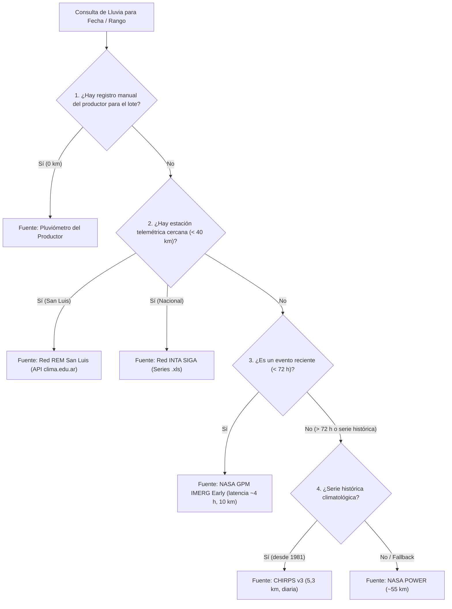

# Spec 016: Lluvia Real del Lote (Jerarquía en Cascada: Pluviómetro, REM/SIGA, GPM IMERG Early y Simulación del Día Anterior)

**Estado:** Borrador para revisión (requiere aprobación de Hernán)  
**Fecha:** 23/11/2026  
**Rama:** `spec/016-lluvia-real-lote`  
**Issue:** #94 (`[51] Lluvia real del lote: pluviómetro del productor + IMERG Early + estación más cercana`)  
**Autor:** Antigravity  

---

## 1. Justificación y Diagnóstico del Problema

### 1.1 El sesgo de los reanálisis globales en eventos convectivos
La modelación del escurrimiento superficial, el anegamiento y la pérdida de suelo depende críticamente de la lámina y la intensidad de la precipitación caída **en el lote específico**.

Hasta el momento, el sistema recurría principalmente a **NASA POWER**, cuya resolución espacial de $0.5^\circ \times 0.625^\circ$ (~55 km) proviene del modelo asimilado MERRA-2. En la región pampeana y cuyana (San Luis, Córdoba, La Pampa, Buenos Aires), la precipitación estival se produce predominantemente mediante **tormentas convectivas de mesoescala**:
- Un evento severo puede descargar 80 mm en un establecimiento y apenas 5 mm a 15 km de distancia.
- Un reanálisis de 55 km suaviza el pico de precipitación, diluyendo tormentas intensas y generando subestimaciones del escurrimiento de hasta un 300 %.
- Por el contrario, un reanálisis puede informar lluvia en una celda de 55 km cuando en el lote del productor no cayó una sola gota.

**Objetivo:** Implementar una **jerarquía estricta en cascada** para seleccionar la mejor fuente pluviométrica disponible, mostrando siempre en la ficha técnica la procedencia exacta y la distancia al lote, e incorporar la funcionalidad interactiva **"Simular la lluvia de ayer"**.

---

## 2. Jerarquía en Cascada de Fuentes Pluviométricas

El conector pluviométrico evalúa secuencialmente la disponibilidad de datos según la distancia y la latencia para la fecha requerida:



### 2.1 Niveles de la Cascada

| Nivel | Fuente | Resolución / Tipo | Distancia máxima | Latencia típica | Privacidad / Términos |
|:---:|---|---|:---:|:---:|---|
| **1** | **Pluviómetro del productor** | Puntual (0 km) | 0 km (en el lote) | Inmediata (manual o CSV) | **Estricta:** Datos privados del productor en SQLite/PostgreSQL local; jamás se commitean a Git. |
| **2a** | **REM San Luis** | Puntual (telemétrica) | $\le 40\text{ km}$ | Horaria / Diaria (1 h) | Pública provincial (`clima.edu.ar`). Conector `#23 / PR #100`. |
| **2b** | **INTA SIGA** | Puntual (estaciones INTA) | $\le 50\text{ km}$ | Diaria (24 h) | Pública abierta (`http://siga.inta.gob.ar/document/series/<id>.xls`). |
| **3** | **NASA GPM IMERG Early** | Grilla $0.1^\circ$ (~10 km) | N/A (satélite) | ~4 horas | Dominio público (GES DISC / NASA Earthdata). |
| **4** | **CHIRPS v3** | Grilla $0.05^\circ$ (~5,3 km) | N/A (satélite + estaciones) | 1 a 2 días | Dominio público (UCSB CHC). Obligatorio v3 (#21). |
| **5** | **NASA POWER** | Grilla $0.5^\circ$ (~55 km) | N/A (reanálisis) | 1 a 2 días | Dominio público (respaldo regional final). |

---

## 3. Funcionalidad "Simular la Lluvia de Ayer"

En la interfaz de usuario (`LluviaTab.tsx` / `RainScenarioSelector.tsx`):
1. **Acción de un clic:** Un botón destacado *"Simular la lluvia de ayer"* consulta la fecha $T - 1$ para las coordenadas del centroide del lote.
2. **Resolución automática de la cascada:**
   - Si el productor ya ingresó el pluviómetro de ayer, usa ese valor (0 km).
   - Si no, busca la estación REM/SIGA más cercana con datos disponibles para ayer.
   - Si la estación no tiene datos aún, consulta GPM IMERG Early (disponible a las 4 h de concluido el día UTC).
3. **Cálculo de la Condición de Humedad Antecedente (AMC):**
   - Se consulta la lluvia acumulada en los 5 días previos ($T-6$ a $T-2$).
   - Se determina el grupo AMC (I Seca, II Normal, III Húmeda) utilizando estrictamente la función unificada `determine_nrcs_amc` con la latitud y el mes según la Tabla 4.2 del manual USDA-NRCS NEH-4 (`geoprocessing/supuestos.py`).

---

## 4. Parámetros en `geoprocessing/supuestos.py`

| Constante | Valor | Unidad | Fuente / Justificación | Editable |
|---|---|---|---|---|
| `SUPUESTO_LLUVIA_REM_DISTANCIA_MAX_KM` | `40.0` | km | Decisión metodológica, Issue #23. Radio máximo de representatividad orográfica en llanura. | Sí |
| `SUPUESTO_LLUVIA_SIGA_DISTANCIA_MAX_KM` | `50.0` | km | Decisión metodológica, Issue #94 para red INTA SIGA. | Sí |
| `SUPUESTO_LLUVIA_IMERG_LATENCIA_EARLY_HORAS` | `4.0` | horas | Especificación técnica NASA GPM IMERG Early Run. | No |

---

## 5. Salidas en API y Ficha Técnica de Resultados

La respuesta del servicio hidrológico expone con transparencia total el origen del dato pluviométrico:

```json
{
  "escenario_lluvia": {
    "fecha": "2026-11-22",
    "precipitacion_mm": 42.5,
    "tipo_escenario": "evento_real_ayer",
    "fuente": {
      "tipo": "estacion_meteorologica",
      "nombre": "REM San Luis · Estación Villa Mercedes",
      "id_estacion": "VMS_04",
      "distancia_lote_km": 11.4,
      "coordenadas": [-33.68, -65.46],
      "latencia_reporte": "1h",
      "url_origen": "http://clima.edu.ar/ObtenerCsv.aspx?tipo=Mensual&estacion=VMS_04"
    },
    "humedad_antecedente": {
      "lluvia_previa_5d_mm": 28.4,
      "estacion_ano": "crecimiento",
      "amc_nrcs": "AMC II",
      "metodo": "NRCS NEH-4 Tabla 4.2"
    }
  }
}
```

---

## 6. Privacidad y Seguridad de Datos del Productor

1. **Aislamiento de datos personales:** Los registros de pluviómetro ingresados manualmente por el usuario o importados desde bitácoras de campo se persisten en el almacenamiento de la sesión del usuario o en base de datos protegida.
2. **Prohibición de commit:** Ningún dato privado de pluviometría ni identificadores de clientes pueden quedar expuestos en repositorios de Git ni en los fixtures de prueba.
3. **Manejo de nulos:** Si una fuente externa no devuelve datos o la distancia supera el límite de representatividad, el sistema degrada explícitamente al siguiente nivel de la cascada registrando el motivo en el reporte de calidad.

---

## 7. Plan de Pruebas Automatizadas (CI sin Internet)

1. **Test de la cascada completa (`test_rainfall_cascade_resolution`):**
   - Con registro de pluviómetro local: devuelve pluviómetro (distancia = 0 km).
   - Sin pluviómetro pero con estación REM a 15 km en fixture: devuelve REM y su etiqueta.
   - Con estación REM a 60 km (> 40 km): ignora REM y pasa a IMERG Early.
   - Sin internet: degrada limpiamente a datos en caché o fixture de respaldo.
2. **Test de coherencia AMC 5 días:**
   - Verifica que el acumulado de los 5 días previos alimente correctamente la función `determine_nrcs_amc` con el mes y la estación fenológica correspondiente.
