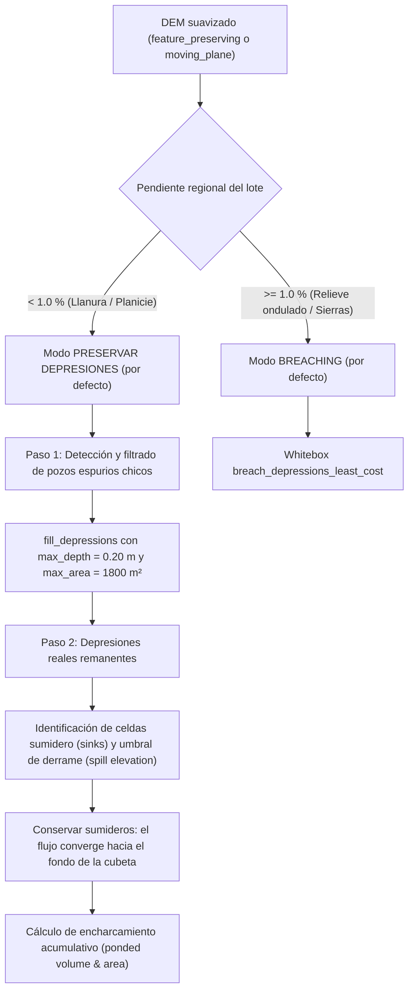

# Spec 030: Depresiones Endorreicas Reales de la Planicie Medanosa (Acondicionamiento "Preservar Depresiones" vs. Breaching)

**Estado:** Borrador para revisión (requiere aprobación de Hernán)  
**Fecha:** 23/11/2026  
**Rama:** `spec/030-depresiones-endorreicas`  
**Issue:** #47 (`[30] Depresiones endorreicas reales: no vaciar las cubetas de deflación de la planicie medanosa`)  
**Autor:** Antigravity  

---

## 1. Justificación Geológica y Geomorfológica

### 1.1 Evidencia de campo: Hoja Geológica 3366-IV Villa Mercedes (SEGEMAR)
El diagnóstico territorial surge del relevamiento oficial de la **Hoja Geológica 3366-IV Villa Mercedes** (Costa et al. 2005, Instituto de Geología y Recursos Minerales, Servicio Geológico Minero Argentino - SEGEMAR, Boletín 348, sección 4 "Geomorfología", pp. 71–74):

| Evidencia geomorfológica | Cita y página (Costa et al. 2005) | Impacto en el modelo hidrológico |
|---|---|---|
| **Drenaje desintegrado y endorreico:** Desde la latitud de Villa Mercedes hacia el sur, la planicie medanosa no posee red fluvial integrada; los escurrimientos son efímeros y drenan a cubetas cerradas de deflación eólica de hasta 150 m de eje mayor. | p. 72: *"Hacia el sur de Villa Mercedes la planicie medanosa carece de una red de drenaje integrada... los cursos son efímeros y de carácter endorreico, finalizando en cubetas de deflación con lagunas temporarias."* | **Crítico:** Las depresiones no son artefactos del DEM sino geoformas cerradas reales donde el escurrimiento converge y se acumula. |
| **Lagunas de origen freático:** Al sur de Villa Mercedes, los cuerpos de agua (Sayapé, Nasau, Capellán, Soven, Las Encadenadas, Los Pocitos) son permanentes o semipermanentes y dependen de la oscilación freática. | p. 74: *"Las lagunas se alojan en cubetas de deflación y su régimen hídrico está íntimamente ligado a las fluctuaciones del nivel freático regional más que a los aportes pluviales directos."* | El anegamiento persistente no se explica solo por balance lluvia-infiltración celda a celda; confirma la necesidad de integrar la profundidad de napa (#40). |
| **Micro-relieve eólico:** Cordones y lomas alargadas N-S de no más de 1,5 m de altura relativa, con longitudes de onda de 250 a 300 m. | p. 74: *"Lomas arenosas longitudinales orientadas N-S que raramente superan 1,5 m de altura relativa y espaciadas entre 250 y 300 m."* | **Límite del DEM 30 m:** El error vertical NMAD ($\approx 1,15\text{ m}$) de Copernicus GLO-30 tiene el mismo orden de magnitud que los cordones de dunas que encierran los bajos. |
| **Pendiente regional ESE:** Caída regional suave desde cotas de 800 m (norte de Fraga) a 300 m (borde oriental). | p. 72: *"Pendiente regional general de rumbo ONO-ESE..."* | La pendiente regional plana ($\approx 0,2\% - 0,4\%$) favorece la acumulación centrípeta en cubetas locales. |

---

## 2. El Problema del Acondicionamiento "Breach" en Llanuras Endorreicas

### 2.1 Por qué el "Breaching" tradicional falsea el anegamiento
En geomorfometría hidrológica clásica (desarrollada predominantemente para cuencas montañosas o con redes fluviales exorreicas integradas), los algoritmos de acondicionamiento digital del terreno asumen que **toda depresión en el DEM es un obstáculo espurio** causado por errores del sensor o vegetación.

El algoritmo estándar implementado en WhiteboxTools (`breach_depressions_least_cost`):
1. Detecta los bordes de la cubeta cerrada.
2. Traza una trinchera artificial de corte (*carving*) a través del umbral de menor cota topográfica.
3. Forza un canal de drenaje continuo hasta evacuar el agua fuera de la cuenca o al borde del dominio.

**Efecto perjudicial en la planicie medanosa:**
- Al aplicar `breach` indiscriminado sobre un lote de Villa Mercedes, Buena Esperanza o Justo Daract, el modelo abre zanjas ficticias a través de los cordones de dunas longitudinales de 1,5 m.
- Las cubetas de deflación naturales se vacían completamente en la simulación.
- El modelo informa **cero encharcamiento** o áreas anegadas subestimadas en más del 80 %, justamente en los bajos que el productor sabe que se inundan periódicamente.

---

## 3. Solución Metodológica: Modo "Preservar Depresiones"

### 3.1 Algoritmo de dos etapas
Se establece un acondicionamiento selectivo gobernado por la física del paisaje:



### 3.2 Criterios de discriminación de pozos (Supuestos calibrables)
Para no confundir errores de cuantización celda a celda con cubetas reales:
1. **Pozo espurio (ruido digital a rellenar):**
   - Profundidad $\le \text{SUPUESTO\_DEPRESION\_MAX\_FILL\_DEPTH\_M}$ ($0,20\text{ m}$).
   - Área $\le \text{SUPUESTO\_DEPRESION\_MAX\_FILL\_AREA\_M2}$ ($1800\text{ m}^2$, equivalente a $\le 2$ celdas de 30 m).
   - Justificación: Ruido de alta frecuencia inherente al filtrado espacial del interferograma SAR / DSM.
2. **Cubeta de deflación real (a preservar):**
   - Extensión $\ge 1800\text{ m}^2$ y profundidad $> 0,20\text{ m}$.
   - Se mantiene intacta la topografía de la cubeta; el algoritmo de acumulación de flujo (MFD/D8) direcciona el escurrimiento hacia el punto de cota mínima interior.

---

## 4. Parámetros en `geoprocessing/supuestos.py`

| Constante | Valor | Unidad | Fuente / Justificación | Editable |
|---|---|---|---|---|
| `SUPUESTO_CONDICIONAMIENTO_MODO_DEFAULT_LLANURA` | `"preservar_depresiones"` | string | Hoja SEGEMAR 3366-IV (Costa et al. 2005, p. 72). | Sí |
| `SUPUESTO_CONDICIONAMIENTO_UMBRAL_PENDIENTE_LLANURA` | `1.0` | % | Pendiente umbral entre planicie medanosa y piedemonte. | Sí |
| `SUPUESTO_DEPRESION_MAX_FILL_DEPTH_M` | `0.20` | m | Desnivel máximo de ruido espurio que se rellena automáticamente. | Sí |
| `SUPUESTO_DEPRESION_MAX_FILL_AREA_M2` | `1800` | $\text{m}^2$ | Área máxima de micro-pozos espurios ($\le 2$ celdas de 30 m). | Sí |

---

## 5. Salidas en API y Ficha Técnica

En el esquema de respuesta del análisis hidrológico (`HydrologyAnalysisResponse` / `QualityReport`):
```json
{
  "acondicionamiento_dem": {
    "modo_aplicado": "preservar_depresiones",
    "motivo": "Pendiente del lote (0.37%) inferior al umbral de llanura (1.0%); paisaje con cubetas de deflación endorreicas (Hoja SEGEMAR 3366-IV)",
    "depresiones_preservadas_n": 3,
    "volumen_almacenamiento_endorreico_m3": 14250.0,
    "superficie_cubetas_ha": 4.85
  }
}
```

En la sección "Límites del modelo" (`docs/model-limitations.md` / `QualityReport.warnings`):
- *"Relieve regional de 30 m (Copernicus GLO-30): El modelo digital no resuelve lomas arenosas y desniveles de menos de ~1,5 m (Costa et al. 2005, p. 74). En lotes con micro-ondulaciones inferiores a este umbral, se recomienda verificar con relevamiento altimétrico propio (RTK/dron)."*

---

## 6. Validación Empírica con Historial de Agua JRC (#41)

Para validar la superioridad del modo "preservar depresiones" sobre "breach":
1. Se toma el lote de prueba de San Luis (`data/sample/san_luis_parcela_205.geojson`).
2. Se descarga la máscara de ocurrencia de agua superficial histórica de JRC Global Surface Water (1984–2024, #41).
3. Se calcula el Índice de Jaccard (Intersection over Union, IoU):
$$\text{IoU} = \frac{\text{Área Anillada Simulación} \cap \text{Ocurrencia Agua JRC}}{\text{Área Anillada Simulación} \cup \text{Ocurrencia Agua JRC}}$$
4. **Criterio de éxito:** El modo "preservar depresiones" debe alcanzar un $\text{IoU}$ al menos 3 veces superior al modo `breach` en la planicie medanosa.

---

## 7. Plan de Pruebas Automatizadas

1. **Test unitario sintético (`test_conditioning_endorheic_sink`):**
   - Grilla sintética de $20 \times 20$ celdas plana ($z = 100\text{ m}$) con una cubeta central de $4 \times 4$ celdas y $1\text{ m}$ de profundidad ($z = 99\text{ m}$).
   - Con modo `"preservar_depresiones"`: el DEM conserva la cota $99\text{ m}$ en el centro y el flujo superficial acumula volumen allí.
   - Con modo `"breach"`: el borde se corta y el centro drena hacia el borde.
2. **Test de micro-pozo espurio (`test_conditioning_spurious_pit_filled`):**
   - Una única celda aislada de $0,15\text{ m}$ de profundidad ($\le 0,20\text{ m}$) se rellena a nivel circundante.
3. **Test de trazabilidad de metadatos:**
   - La respuesta API devuelve `modo_aplicado: "preservar_depresiones"` y cita la Hoja SEGEMAR 3366-IV en el motivo.
