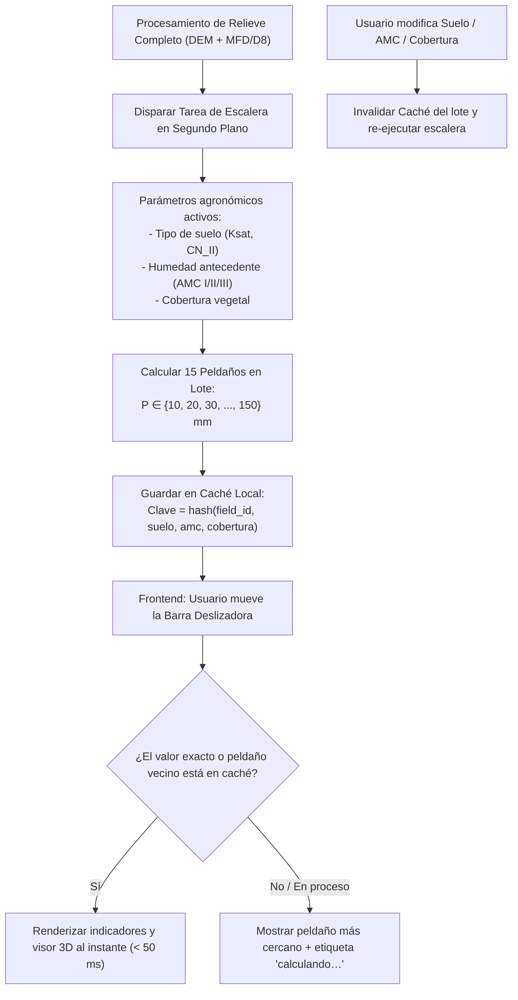

# Spec 031: Barra Deslizadora de Milímetros con Escalera de Simulaciones Precalculada (Opción B)

**Estado:** Borrador para revisión (requiere aprobación de Hernán)  
**Fecha:** 23/11/2026  
**Rama:** `spec/031-barra-mm-escalera-precalculada`  
**Issue:** #113 (`[56] Barra deslizadora de milímetros con escalera de simulaciones precalculada`)  
**Autor:** Antigravity  

---

## 1. Justificación y Diagnóstico del Problema

### 1.1 Limitaciones del selector rígido actual
En el flujo actual de configuración hidrológica (`RainStep.tsx:43-45`, `App.tsx:264-267`):
- El usuario solo dispone de 3 botones estáticos predeterminados: **30 mm**, **80 mm** y **130 mm**.
- Las etiquetas textuales *"Tormenta de diseño (80 mm)"* y *"Crecida extraordinaria (130 mm)"* carecen de respaldo estadístico o meteorológico regional.
- Al contrastar estos valores con la serie histórica de precipitación máxima diaria de la estación telemétrica REM Villa Mercedes (ajuste de distribución extrema Gumbel para el período 2008–2025, Issue #81):
  - $T_2 \approx 52\text{ mm}$ (evento bienal frecuente).
  - $T_{10} \approx 77\text{ mm}$ (tormenta decenal).
  - $T_{25} \approx 89\text{ mm}$ (evento de 25 años).
  - $T_{50} \approx 98\text{ mm}$ (evento cincuentenal).
- Por lo tanto, el valor de 80 mm se ubica entre $T_{10}$ y $T_{25}$, mientras que 130 mm excede con holgura el evento de 50 años ($98\text{ mm}$), descontextualizando el riesgo real para el productor de la zona.

### 1.2 Objetivo
1. Reemplazar los botones fijos por una **barra deslizadora continua** de 5 a 150 mm (paso de 5 mm), sincronizada bidireccionalmente con un campo de entrada numérico directo (con coma decimal).
2. Marcar sobre el slider los períodos de retorno reales ($T_2, T_{10}, T_{25}, T_{50}$) obtenidos de la estación meteorológica más cercana (< 40 km), con tooltip que exponga la fuente estadística transparente. Sin estación cercana disponible, la barra permanece sin marcas arbitrarias.
3. Implementar la **Opción B (Escalera Precalculada)**: un pipeline en segundo plano que precalcula la respuesta hidrológica del lote en una grilla de milímetros (10 a 150 mm cada 10 mm) para ofrecer interactividad instantánea al deslizar el control.
4. Generar la curva característica *"Hectáreas anegadas vs. mm de lluvia"* para detectar visualmente el **umbral de anegamiento del lote** (quiebre donde colapsa la retención en cubetas y se desata el escurrimiento generalizado).

---

## 2. Arquitectura de la Escalera Precalculada (Opción B)



### 2.1 Especificación del Pipeline de Cómputo
1. **Disparo automático:** Inmediatamente después de que el endpoint de relieve finaliza el cálculo de direcciones de flujo, depresiones y pendientes filtradas, el backend inicia la resolución de la escalera.
2. **Peldaños base:** 15 simulaciones distribuidas equiespaciadamente:
   $$\mathcal{P}_{\text{escalera}} = \{10, 20, 30, 40, 50, 60, 70, 80, 90, 100, 110, 120, 130, 140, 150\}\text{ mm}$$
3. **Optimización matemática del cálculo:**
   - La matriz topográfica (área acumulada MFD, pendientes de ladera, umbrales de derrame de cubetas) es invariante para un lote dado y se calcula **una sola vez**.
   - Para cada peldaño $P_i$, la rutina aplica el modelo NRCS-CN hidrológico vectorizado celda a celda:
     $$Q_i = \frac{(P_i - I_a)^2}{P_i - I_a + S}, \quad P_i > I_a$$
   - Se llena el volumen de depresiones conservadas y se computa el área de encharcamiento remanente, el caudal pico y la erosión USLE correspondiente.
4. **Almacenamiento en caché:**
   - Estructura en memoria LRU / SQLite de sesión indexada por clave:
     $$\text{clave\_cache} = \text{SHA256}(\text{field\_id} + \text{soil\_id} + \text{amc\_group} + \text{management\_id})$$
   - La entrada almacena el vector de 15 tuplas:
     $$\{P_i, \text{ponded\_ha}_i, \text{ponded\_pct}_i, \text{outflow\_m3}_i, \text{soil\_loss\_tha}_i\}$$

### 2.2 Presupuesto y Degradación por Tiempo de Cómputo
- **Límite objetivo:** Para un lote estándar de $150\text{ ha}$ a resolución de 30 m (~16.600 celdas), el tiempo total de cómputo de los 15 peldaños debe ser $\le 60\text{ s}$ en entorno de servidor mononúcleo.
- **Mecanismo de degradación automática:**
  - Si en el entorno local o en lotes extensos (> 500 ha) el tiempo acumulado de los primeros 3 peldaños proyecta una duración superior a 60 s, el worker commuta automáticamente a **pasos de 20 mm** (8 peldaños: $10, 30, 50, 70, 90, 110, 130, 150\text{ mm}$).
  - El frontend interpola linealmente los valores intermedios para garantizar respuesta fluida al deslizamiento.

---

## 3. Experiencia de Usuario e Interfaz Gráfica

### 3.1 Control Deslizador (`RainfallSlider.tsx`)
1. **Rango:** $5\text{ mm}$ a $150\text{ mm}$ con incrementos de $5\text{ mm}$.
2. **Entrada dual:** Deslizador táctil/mouse asistido por campo de texto numérico editable contiguo. Si el usuario escribe "65", el deslizador se desplaza a 65 mm.
3. **Hitos de Período de Retorno ($T_r$):**
   - Marcas visuales verticales en la regleta si existe estación meteorológica calibrada en radio $\le 40\text{ km}$:
     - Ejemplo Villa Mercedes: $T_2$ (52 mm), $T_{10}$ (77 mm), $T_{25}$ (89 mm), $T_{50}$ (98 mm).
   - Tooltip explicativo: *"Evento con recurrencia promedio de 10 años (77 mm en 24 h). Fuente: REM San Luis · Estación Villa Mercedes (Gumbel 2008–2025)."*
4. **Formato regional:** Valores numéricos formateados con coma decimal (e.g. `14,2 ha`, `11,8 %`, `77,0 mm`).

### 3.2 Mini-gráfico: Umbral de Anegamiento del Lote
Debajo de la barra se despliega un gráfico compacto interactivo:
- **Eje X:** Precipitación acumulada (mm).
- **Eje Y:** Superficie anegable simulada (ha).
- **Puntos de la escalera:** Los 15 puntos precalculados con línea de tendencia suave.
- **Marcador del punto activo:** Un punto destacado móvil indica la posición actual del slider.
- **Detección automática de codo:** El sistema calcula la segunda derivada discreta $\frac{\Delta^2 \text{ha}}{\Delta P^2}$ e identifica el punto de máxima curvatura (*knee point*), etiquetándolo como:
  $$\text{"Umbral crítico de anegamiento del lote: } P_{\text{crit}} \approx 60\text{ mm"}$$
  A partir de dicho valor, la capacidad de infiltración y almacenamiento en micro-bajos se satura y el agua invade sectores productivos planos.

### 3.3 Conexión con Visor 3D y Línea Temporal
- Al deslizar la barra de milímetros, el mapa 2D y el visor 3D actualizan el nivel estático de llenado de cubetas y la tasa de escurrimiento.
- El componente `FlowTimelinePlayer` (animación temporal de la tormenta) adapta automáticamente su hietograma normalizado a la nueva lámina total seleccionada, permitiendo recorrer la dinámica de avance hora por hora para ese milimetraje específico.

---

## 4. Contrato de API y Esquema de Respuestas

### 4.1 Endpoint de Escalera Precalculada
`GET /api/v1/fields/{field_id}/hydrology/rainfall-ladder`

**Parámetros query:**
- `soil_id`: identificador de suelo INTA / textura.
- `amc`: condición de humedad antecedente (`"dry"`, `"medium"`, `"wet"`).
- `cover_type`: cobertura vegetal activa.

**Respuesta JSON:**
```json
{
  "field_id": "campo_don_roberto_12",
  "status": "ready",
  "parameters": {
    "soil_id": "SL_VM_04",
    "amc": "medium",
    "cn_base": 78.0
  },
  "benchmark_timing_ms": 1420,
  "step_size_mm": 10,
  "critical_ponding_threshold_mm": 60.0,
  "return_periods_station": {
    "station_id": "REM_VMS_04",
    "station_name": "REM San Luis · Villa Mercedes",
    "distance_km": 14.2,
    "method": "Gumbel 2008-2025",
    "milimetros": {
      "T2": 52.1,
      "T10": 76.8,
      "T25": 88.9,
      "T50": 98.4
    }
  },
  "ladder": [
    {
      "precipitation_mm": 10,
      "ponded_area_ha": 0.42,
      "ponded_area_pct": 0.35,
      "outflow_volume_m3": 0.0,
      "soil_loss_t_ha_yr": 0.12
    },
    {
      "precipitation_mm": 50,
      "ponded_area_ha": 4.15,
      "ponded_area_pct": 3.46,
      "outflow_volume_m3": 1250.0,
      "soil_loss_t_ha_yr": 1.45
    },
    {
      "precipitation_mm": 80,
      "ponded_area_ha": 14.20,
      "ponded_area_pct": 11.83,
      "outflow_volume_m3": 8940.0,
      "soil_loss_t_ha_yr": 4.10
    },
    {
      "precipitation_mm": 150,
      "ponded_area_ha": 38.60,
      "ponded_area_pct": 32.17,
      "outflow_volume_m3": 28400.0,
      "soil_loss_t_ha_yr": 11.80
    }
  ]
}
```

---

## 5. Parámetros en `geoprocessing/supuestos.py`

| Constante | Valor | Unidad | Fuente / Justificación | Editable |
|---|---|---|---|---|
| `SUPUESTO_ESCALERA_LLUVIA_MIN_MM` | `10` | mm | Lluvia mínima del ensayo precalculado. | Sí |
| `SUPUESTO_ESCALERA_LLUVIA_MAX_MM` | `150` | mm | Lluvia máxima de la escalera. | Sí |
| `SUPUESTO_ESCALERA_LLUVIA_PASO_DEFAULT_MM` | `10` | mm | Resolución por defecto (15 peldaños). | Sí |
| `SUPUESTO_ESCALERA_LLUVIA_PASO_DEGRADADO_MM` | `20` | mm | Resolución reducida si el cómputo proyecta > 60 s. | Sí |
| `SUPUESTO_ESCALERA_MAX_TIEMPO_COMPUTO_S` | `60.0` | s | Límite máximo admisible de CPU para lotes extensos. | Sí |

---

## 6. Plan de Pruebas Automatizadas (CI sin Internet)

1. **Test unitario de caché e invalidación (`test_rainfall_ladder_cache`):**
   - Ejecuta la escalera para un lote sintético; comprueba que la segunda consulta se resuelva desde memoria en $< 2\text{ ms}$.
   - Modifica el parámetro `amc` de `"medium"` a `"wet"`; comprueba que la caché se invalide y se recalcule la nueva curva.
2. **Test de monotonicidad de la escalera (`test_rainfall_ladder_monotonicity`):**
   - Comprueba estrictamente que a mayor lámina de precipitación, la superficie anegable y el volumen escurrido sean monótonamente no decrecientes:
     $$\forall i < j \implies \text{ponded\_ha}_i \le \text{ponded\_ha}_j \quad \land \quad \text{outflow}_i \le \text{outflow}_j$$
3. **Test de rendimiento (`test_rainfall_ladder_benchmark`):**
   - Ejecuta la rutina sobre un DEM sintético de $150\text{ ha}$ (grilla $130 \times 130$ a 30 m) y verifica que el tiempo total de los 15 peldaños permanezca bajo los 60 s.
4. **Test E2E de interfaz Playwright (`test_rainfall_slider_interaction.spec.ts`):**
   - Carga la vista de análisis hidrológico.
   - Desplaza el slider de 30 mm a 80 mm; valida que las etiquetas de porcentaje anegable y volumen se actualicen inmediatamente sin recargar la página.
   - Verifica el formato de coma decimal en los textos renderizados (`"11,8 %"`).
