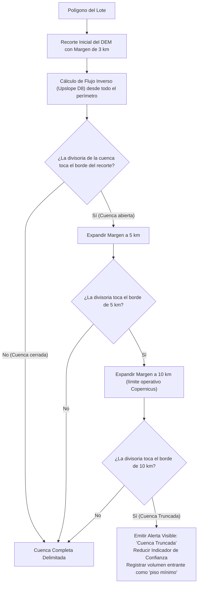

# Spec 032: Cuenca de Aporte Completa, Vías de Concentración, Alcantarillas y Riesgo de Ríos Nuevos

**Estado:** Borrador para revisión (requiere aprobación de Hernán)  
**Fecha:** 23/11/2026  
**Rama:** `spec/032-cuenca-aporte-completa-rios-nuevos`  
**Issue:** #114 (`[57] Todo lo que baja hacia el lote: cuenca de aporte completa, cauces y riesgo de ríos nuevos`)  
**Autor:** Antigravity  

---

## 1. Justificación y Diagnóstico del Problema

### 1.1 El sesgo del buffer arbitrario de 300 m
En la implementación actual (`App.tsx:261, 335, 404`, `flow.py:subbasin_external_inflow_ha`):
- El área externa se recorta a un buffer fijo de apenas **300 m** alrededor del perímetro del lote.
- En paisajes llanos o de piedemonte, la cuenca vertiente que desagua hacia un lote suele extenderse por varios kilómetros a través de campos vecinos, caminos rurales y divisorias regionales.
- El recorte a 300 m **trunca la cuenca aguas arriba en silencio y sin avisar al usuario**, subestimando drásticamente el volumen y caudal pico de agua externa que ingresa por los alambrados.

### 1.2 Lotes situados sobre cauces y vías de escurrimiento
- La herramienta no alerta al productor si su lote está emplazado sobre una vía de drenaje natural concentrada o cauce activo.
- Tampoco evalúa el comportamiento de las cubetas y depresiones vecinas aguas arriba, las cuales retienen agua hasta que colapsan y desbordan en cascada (*fill-and-spill*).
- Los terraplenes viales o ferroviarios que actúan como diques temporarios con alcantarillas no están individualizados como puntos forzados de entrada o salida.

### 1.3 El fenómeno de "Ríos Nuevos" en San Luis
En la cuenca del Río Quinto y la cuenca de El Morro (departamentos General Pedernera y Pringles, San Luis), la deforestación histórica y el reemplazo del pastizal/espinal por agricultura anual han inducido un ascenso regional de la capa freática. Cuando la napa superficial intersecta sedimentos loéssicos friables y ricos en sodio, se desencadena un proceso de **erosión interna por tubificación (*piping* / *sapping*)** y colapso súbito del terreno, dando origen a cañones y cauces fluviales permanentes donde antes no existían:
- **Evidencia científica canónica comprobada:** Contreras, S., Santoni, C. S., & Jobbágy, E. G. (2013). *"Abrupt watercourse formation in a semiarid sedimentary landscape of central Argentina: The roles of forest clearing, rainfall variability and seismic activity"*. *Ecohydrology*, 6(5), 794–805. DOI: [10.1002/eco.1302](https://doi.org/10.1002/eco.1302).
- Evidencia geomorfológica regional complementaria: Hoja Geológica 3366-IV Villa Mercedes (Costa et al. 2005, SEGEMAR Boletín 348, p. 72).

---

## 2. Metodología de Delimitación de Cuenca Adaptativa



### 2.1 Algoritmo de Expansión Adaptativa (3 → 5 → 10 km)
1. **Margen inicial:** Se extrae una ventana de DEM con buffer de $3\text{ km}$ a partir de la envolvente convexa del lote.
2. **Trazado de cuenca vertiente:** Se aplica el operador de acumulación aguas arriba (*upslope contributing area*) utilizando la totalidad de celdas perimetrales del lote como sumideros receptores.
3. **Control de frontera:** Si las celdas de la cabecera de la cuenca intersectan el borde exterior del ráster, el algoritmo expande secuencialmente el margen a $5\text{ km}$ y finalmente a $10\text{ km}$.
4. **Condición de truncamiento:** Si a los $10\text{ km}$ la cuenca continúa excediendo el dominio:
   - Se marca la bandera booleana `upstream_catchment_truncated = True`.
   - Se despliega una advertencia prominente en la interfaz y en el reporte:
     $$\text{"Cuenca de aporte externa truncada a 10 km: el caudal y volumen calculados representan un piso mínimo."}$$
   - Se descuenta una penalización de $0,15$ puntos en el índice de confianza hidrológica (`confidence.py`).

---

## 3. Lote en Vía de Escurrimiento y Cruce con Redes Oficiales

### 3.1 Detección Topográfica de Cauce
Una celda se clasifica como perteneciente a una **vía de escurrimiento principal / cauce concentrado** si su área acumulada aguas arriba supera el umbral declarado:
$$\mathcal{A}_{\text{aporte}} \ge \text{SUPUESTO\_CAUCE\_AREA\_APORTE\_MIN\_HA} \quad (50\text{ ha por defecto, calibrable)}$$

Si dentro del lote o en un radio $\le 60\text{ m}$ de su alambrado discurren celdas que superan este umbral:
- Se activa la bandera `lot_in_flowpath = True`.
- Se calcula la longitud total del tramo de cauce interno (m) y su pendiente media longitudinal.

### 3.2 Cruce con Capa Oficial del IGN y Persistencia JRC
1. **Red Hidrográfica IGN:** Se contrasta el trazado topográfico contra las líneas de cursos de agua permanentes e intermitentes de la base oficial del Instituto Geográfico Nacional (IGN, capa WFS `ign:linea_hidrografica` o extracto vectorial offline empaquetado en el fixture territorial).
2. **Ocurrencia Histórica de Agua JRC (#41):** Se superpone con el ráster de frecuencia de agua superficial JRC Global Surface Water (1984–2024).
3. **Alerta visual en UI:** Si hay coincidencia, la ficha técnica informa:
   $$\text{"ALERTA: El lote intercepta el cauce hidrológico oficial ['Nombre' o 'Sin nombre'] (IGN)."} $$

---

## 4. Dinámica Hidrológica Aguas Arriba: *Fill-and-Spill* y Escenarios Críticos

### 4.1 Retención en Cascada de Cubetas Vecinas (*Fill-and-Spill*)
En la planicie medanosa y llanura periserrana, las cubetas de deflación situadas aguas arriba retienen el escurrimiento inicial hasta alcanzar su cota de derrame (*spill elevation*):
1. **Fase de llenado:** Mientras la precipitación neta no supere la capacidad de almacenamiento de la cubeta vecina ($V_{\text{almacenamiento}}$), el aporte hacia el lote aguas abajo es nulo.
2. **Fase de desborde:** Una vez colmada la depresión, el $100\%$ del excedente subsiguiente se vierte instantáneamente hacia el cauce aguas abajo.
3. El modelo simula este balance de almacenamiento retenido celda a celda sin vaciar artificialmente las cubetas por *breaching* indiscriminado (coherente con Spec 030).

### 4.2 Obligatoriedad del Escenario AMC III (Suelo Saturado)
Para evaluar el riesgo real en crecidas de cuenca, las simulaciones de diseño ($T_2, T_{10}, T_{25}, T_{50}$ de la estación más cercana según Issue #81) deben presentarse obligatoriamente en dos estados de humedad:
1. **Condición Media (AMC II):** Estado de referencia habitual.
2. **Condición Húmeda / Saturada (AMC III):** Condición crítica tras lluvias reiteradas en los 5 días previos, donde la retención potencial máxima del suelo $S$ se reduce drásticamente:
   $$S_{\text{III}} \approx 0,43 \cdot S_{\text{II}}$$
   Esto permite dimensionar las obras y los terraplenes para el escenario en el que ocurren los desastres hídricos.

---

## 5. Caminos, Terraplenes y Alcantarillas

1. **Identificación de barreras antropogénicas:** Los caminos rurales, terraplenes ferroviarios y bordos de canales actúan como albardones que represan el escurrimiento.
2. **Apertura controlada en alcantarillas:**
   - Si se identifican o cargan cruces de alcantarillas, el modelo ejecuta una apertura de brecha focalizada (`breach_depressions_least_cost`, Lindsay 2016) restringida exclusivamente al ancho de la calzada ($\le 2$ celdas de 30 m), preservando el albardón lateral.
   - Si no hay alcantarilla relevada, el camino retiene agua hasta su nivel de coronamiento (*overtopping*).

---

## 6. Susceptibilidad a "Ríos Nuevos" y Erosión por Tubificación (*Piping*)

### 6.1 Mecanismo de iniciación (Contreras et al. 2013)
El riesgo de formación súbita de cárcavas de gran escala (*gullies*) y nuevos cauces fluviales por ascenso freático se evalúa en base a 3 factores biofísicos:
1. **Contexto hidrogeológico:** Cuenca de la Sierra del Morro / abanico aluvial del Río Quinto (departamentos Pedernera / Pringles / Chacabuco).
2. **Profundidad de napa freática:** Napa a menos de $1,5\text{ m}$ de la superficie del suelo (asociado a Issue #40).
3. **Tensión de corte hidráulica en el cauce ($\tau$):**
   $$\tau = \gamma_w \cdot R_h \cdot S$$
   Donde $\gamma_w = 9810\text{ N/m}^3$, $R_h$ es el radio hidráulico y $S$ la pendiente local.
   - En sedimentos loéssicos friables, si $\tau \ge 15\text{ N/m}^2$ y la napa está próxima al suelo, el material colapsa por disolución de sales y arrastre de finos (*piping*).

### 6.2 Indicador de Riesgo en la UI
- **Riesgo Alto:** Zona de piedemonte loéssico con napa alta y escurrimiento concentrado $\ge 50\text{ ha}$. Se añade la advertencia:
  $$\text{"Zona de alta susceptibilidad a tubificación y cárcavas súbitas (Río Nuevo / El Morro, Contreras et al. 2013)."}$$
- **Riesgo Bajo / Nulo:** Llanura medanosa profunda sin pendientes concentradas ni napa en superficie.

---

## 7. Salidas en API y Ficha Hidrológica del Lote

```json
{
  "cuenca_vertiente": {
    "area_total_ha": 348.5,
    "area_externa_ha": 222.3,
    "area_interna_lote_ha": 126.2,
    "margen_alcanzado_km": 5.0,
    "cuenca_truncada": false,
    "volumen_ingresante_externo_m3": 48600.0,
    "lote_en_via_de_escurrimiento": true,
    "cauce_ign_coincidente": "Arroyo Seco / Cañada de los Ceibos",
    "puntos_ingreso_perimetro": [
      {
        "id": "IN-01",
        "coordenadas": [-33.642, -65.412],
        "sector": "Alambrado Norte",
        "volumen_m3": 34100.0,
        "caudal_pico_m3_s": 4.85,
        "velocidad_max_m_s": 1.42,
        "tension_corte_n_m2": 18.2
      }
    ],
    "puntos_egreso_perimetro": [
      {
        "id": "OUT-01",
        "coordenadas": [-33.655, -65.398],
        "sector": "Alambrado Este",
        "volumen_total_salida_m3": 61200.0,
        "caudal_pico_m3_s": 6.10
      }
    ],
    "riesgo_rios_nuevos": {
      "nivel": "alto",
      "motivo": "Suelo loéssico en faldeo de El Morro con napa freática alta y tensión de corte > 15 N/m²",
      "referencia_cientifica": "Contreras, Santoni & Jobbágy (2013, Ecohydrology 6(5): 794–805)"
    },
    "aviso_desvio_escurrimiento": "Cualquier diseño de terrazas (#79/#80) que altere el punto de salida OUT-01 hacia lotes linderos debe ser verificado agronómicamente (información descriptiva, sin consejo legal)."
  }
}
```

---

## 8. Parámetros en `geoprocessing/supuestos.py`

| Constante | Valor | Unidad | Fuente / Justificación | Editable |
|---|---|---|---|---|
| `SUPUESTO_CUENCA_MARGEN_INICIAL_KM` | `3.0` | km | Margen base de recorte del DEM. | Sí |
| `SUPUESTO_CUENCA_MARGEN_EXPANSION_KM` | `5.0` | km | Primera expansión si la divisoria está abierta. | Sí |
| `SUPUESTO_CUENCA_MARGEN_MAXIMO_KM` | `10.0` | km | Límite máximo admisible para ráster de 30 m sin desbordar memoria. | Sí |
| `SUPUESTO_CAUCE_AREA_APORTE_MIN_HA` | `50.0` | ha | Área de aporte para considerar vía de escurrimiento principal / cauce. | Sí |
| `SUPUESTO_PIPING_TENSION_CORTE_CRITICA_N_M2` | `15.0` | $\text{N/m}^2$ | Supuesto metodológico, calibrable; umbral orientativo de tensión de arrastre para inicio de tubificación en loess. | Sí |

---

## 9. Plan de Pruebas Automatizadas (CI sin Internet)

1. **Test de aviso de cuenca truncada (`test_catchment_truncation_warning`):**
   - Se genera un DEM sintético inclinado de gran escala donde la cuenca real requiere 15 km de extensión.
   - Se restringe el recorte a 10 km; el test comprueba que `cuenca_truncada == True`, que se emita la advertencia textual explícita en la respuesta y que el puntaje de confianza disminuya.
2. **Test de bandera de lote en cauce (`test_lot_in_flowpath_flag`):**
   - DEM sintético con una cárcava central concentrada (> 50 ha de aporte que cruza el lote); comprueba que `lote_en_via_de_escurrimiento == True`.
   - Lote plano en ladera difusa (< 10 ha de aporte); comprueba que la bandera permanezca en `False`.
3. **Test de balance fill-and-spill en cubetas vecinas (`test_upstream_fill_and_spill`):**
   - Una cubeta vecina aguas arriba de $5000\text{ m}^3$ de capacidad.
   - Lluvia chica ($3000\text{ m}^3$ producidos): aporte hacia el lote = 0.
   - Lluvia grande ($8000\text{ m}^3$ producidos): la cubeta retiene $5000\text{ m}^3$ y transfiere exactamente los $3000\text{ m}^3$ excedentes al lote.
4. **Test de conservación de masa perimetral:**
   - Comprueba que el volumen ingresante externo + lluvia directa neta en el lote sea exactamente igual al volumen retenido en cubetas internas + volumen egresante por los puntos de salida.
